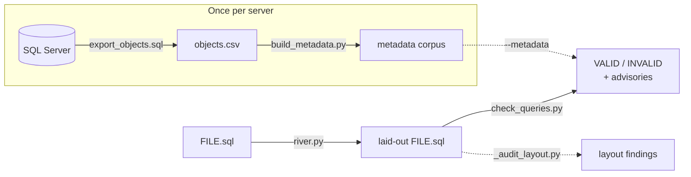

# sql-tools

Offline tools for writing T-SQL with no SQL Server to test against: a
legality checker for SQL Server 2016, a formatter for a right-aligned
"keyword river" layout, and a script that builds a column catalogue from your
own server so the checker can catch misspelt columns. Python 3.10+ standard
library only (the checker vendors sqlglot), no install step.

They were built for LLM coding agents that write SQL for a server they cannot
reach, but nothing in them assumes an agent.



| Tool | What it does |
| --- | --- |
| [`tools/sql-server-2016-query-check`](tools/sql-server-2016-query-check/README.md) | Parses each statement with sqlglot and checks it against SQL Server 2016: post-2016 features, GROUP BY / window / ORDER BY / subquery / UNION rules sqlglot does not enforce, temp-table lifecycle, alias resolution, column existence (with `--metadata`), and optional house-style decomposition rules (`--debug`). Exit 1 on any error. |
| [`tools/river-layout`](tools/river-layout/README.md) | `river.py FILE.sql` puts every governed statement on the keyword river of [`SQL-STYLE.md`](SQL-STYLE.md), proves no token changed, and audits the result. Whitespace only. |
| [`tools/sqlserver-metadata`](tools/sqlserver-metadata/README.md) | `export_objects.sql` (run on the server) plus `build_metadata.py` (run here) build the corpus that `--metadata` reads. |
| [`SQL-STYLE.md`](SQL-STYLE.md) | The layout and naming rules the formatter implements and the checker's alias rule enforces. |

## Try it

```sh
# 7 statements, all valid
python3 tools/sql-server-2016-query-check/check_queries.py examples/sales_by_customer.sql

# a misspelt column in a base table and in a #temp table: exit 1
python3 tools/sql-server-2016-query-check/check_queries.py examples/bad_columns.sql --metadata examples/metadata

# lay out a careless file (on a copy), then confirm a second pass moves nothing
cp examples/river/messy.sql /tmp/messy.sql
python3 tools/river-layout/river.py /tmp/messy.sql
python3 tools/river-layout/_river_layout.py /tmp/messy.sql     # moved 0 lines, joined 0
```

The examples use a four-table demo schema (`customers`, `orders`, `products`,
`order_lines`); `examples/metadata/` is its corpus.

## Limits

- The checker checks what can be decided from the text. It is not a server:
  types, permissions and plans are out of reach, and rules that need the
  schema are reported as advisories.
- `STRING_AGG` and `WITHIN GROUP` (2017) are treated as available; see the
  checker README to change that.
- `river-layout` is a text model, not a parser. It leaves any statement it
  cannot settle legal and unchanged, and logs it under
  `tools/river-layout/issues/` (git-ignored).

## Licence

MIT. sqlglot is vendored under its own MIT licence
(`tools/sql-server-2016-query-check/_vendor/LICENSE-sqlglot`).
