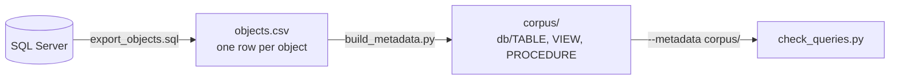

# sqlserver-metadata

The query checker's column-existence check needs to know which columns each
table and view has. This folder builds that knowledge from your own server, in
two steps:



1. **On the server:** run `export_objects.sql` in SSMS (needs `VIEW DEFINITION`;
   SQL Server 2017+, or swap one `STRING_AGG` for 2016). It harvests every
   online user database, skipping names that look like dev/test copies, and
   leaves a table `dbo.ObjectExport` behind. Get it out with `bcp`, exactly as
   the script's header says. Do not use the SSMS grid for big databases: it
   silently truncates cells at 65,535 characters.
2. **Here:**

   ```sh
   python3 tools/sqlserver-metadata/build_metadata.py --csv objects.csv --out corpus/
   python3 tools/sql-server-2016-query-check/check_queries.py FILE.sql --metadata corpus/
   ```

`build_metadata.py` deletes and rebuilds `--out` each time. It refuses to
delete a non-empty folder that it did not build itself (it marks its own with
an empty `.sqlserver-metadata` file).

Tables are written as a synthesised `CREATE TABLE` (column names, types,
nullability); views and procedures keep their real definitions. Each file is
`<out>/<database>/<TABLE|VIEW|PROCEDURE>/[db].[schema].[name].sql` with a short
`-- Object:` header. The corpus is plain text, so `grep -rl` over it is also
the fastest way to find which objects already compute something.

`examples/metadata.csv` is a five-object demo of the CSV format;
`examples/metadata/` is what `build_metadata.py` makes of it.

Your corpus holds your organisation's code. Keep it out of any public repo.
